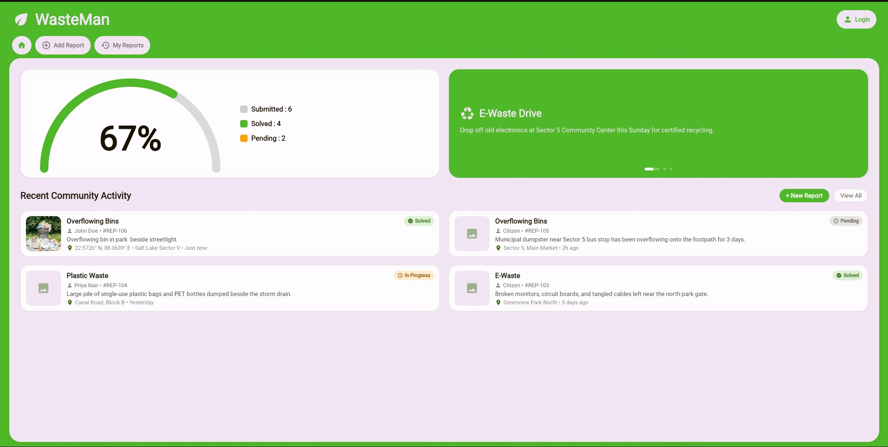
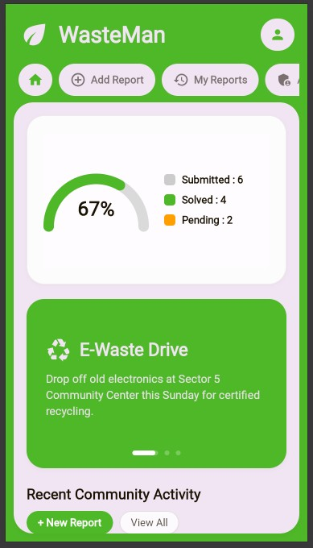

# WasteMan

**WasteMan** is a Kotlin Multiplatform & Compose Multiplatform (WasmJS) civic waste-reporting web application backed by a Ktor server. Citizens can report local waste issues with photos, GPS coordinates, or Google Maps locations, track resolution progress, and allow municipal admins to triage and resolve reports in real time.

---

## Screenshots

| Desktop View | Mobile View (`< 680dp`) |
| :---: | :---: |
|  |  |

---

## Features

- **Live Resolution Dashboard**: Animated circular gauge (`Submitted`, `Solved`, `Pending`) that counts up on load alongside an auto-advancing community announcements carousel.
- **Report Submission**:
  - Category selection (`Overflowing Bins`, `Plastic Waste`, `E-Waste`, `Littering`, `Hazardous Waste`, etc.).
  - Photo evidence upload from disk (persisted on the Ktor server and served via `/uploads/...`).
  - **Use GPS** (browser Geolocation API) and an interactive **Google Maps** location picker modal with search, hotspots, and GPS centering.
- **Search & Collapsible Filters**: Filter reports by time window, status (`Pending`, `In Progress`, `Solved`), waste category, or search keywords. Filters automatically collapse on narrow/mobile screens (`< 680dp`).
- **Role-Based Access & Privacy**:
  - **Citizens** see only their own submitted reports in **My Reports**; `reporterPhone` is stripped from public API responses and citizen UI feeds.
  - **Admins** unlock the **Admin Panel** to view all reports, inspect reporter contact details, and update resolution statuses immediately via card dropdowns or the detail dialog.
- **Offline Demo Fallback**: If the Ktor server is unreachable on startup, the app gracefully falls back to `DemoWasteManBackend` and reconnects seamlessly on login once the server is running.

---

## Project Structure

Built using the [Kotlin Toolchain / Amper](https://kotlin-toolchain.org/dev/) (`./kotlin` on macOS/Linux, `kotlin.bat` on Windows):

- [`core/`](core) — Shared Kotlin Multiplatform module (`jvm`, `wasmJs`) containing `@Serializable` DTOs (`Models.kt`), `WasteManBackend`, and `KtorWasteManBackend`.
- [`server/`](server) — Ktor Netty backend (`http://127.0.0.1:8081`) with REST endpoints, bearer-token auth, JSON persistence (`data/reports.json`), and uploaded image storage (`uploads/`).
- [`app/shared/`](app/shared) — Compose Multiplatform UI, Material 3 theming, `AppState`, and WasmJS browser handlers (`src@wasmJs`).
- [`app/webApp/`](app/webApp) — WebAssembly entry point served at `http://127.0.0.1:8080`.
- [`docs/`](docs) — Application screenshots used in documentation.

---

## How to Run the Project

> **Note:** Start the `server` module (`8081`) first so the `webApp` (`8080`) connects to the live backend immediately on load.

### Option 1: Using Android Studio (or IntelliJ IDEA)

1. **Open the Project**:
   - Launch **Android Studio** (or IntelliJ IDEA) and select **File → Open...**, then choose the `WasteMan` root directory.
   - Wait for the initial Amper / Kotlin project sync and indexing to complete.
2. **Start the Ktor Backend (`server`)**:
   - In the top toolbar **Run Configurations** dropdown, select **`server`**.
   - Click **Run** (▶). Wait until the Run console prints:
     `Responding at http://127.0.0.1:8081`
3. **Start the Web App (`webApp`)**:
   - In the **Run Configurations** dropdown, select **`webApp`**.
   - Click **Run** (▶). Wait until the console prints:
     `Responding at http://127.0.0.1:8080`
4. **Open in Browser**:
   - Visit **[http://127.0.0.1:8080](http://127.0.0.1:8080)** in Chrome, Edge, or Firefox.

### Option 2: Using the Command Line

The `kotlin` / `kotlin.bat` wrapper automatically downloads and runs the pinned toolchain version with no extra setup.

**Windows (PowerShell / CMD):**
```powershell
# Terminal 1: Start the Ktor backend server (port 8081)
.\kotlin.bat run -m server

# Terminal 2: Start the Compose WasmJS web app (port 8080)
.\kotlin.bat run -m webApp

# Optional: Build all modules or run server tests
.\kotlin.bat build
.\kotlin.bat test -m server
```

**macOS / Linux:**
```bash
# Terminal 1: Start the Ktor backend server (port 8081)
./kotlin run -m server

# Terminal 2: Start the Compose WasmJS web app (port 8080)
./kotlin run -m webApp

# Optional: Build all modules or run server tests
./kotlin build
./kotlin test -m server
```

---

## How to Preview Mobile Mode Using Browser DevTools

WasteMan switches automatically between its 2-column desktop layout and compact single-column mobile layout at the **`680.dp`** width breakpoint.

### Chrome / Microsoft Edge
1. Open **[http://127.0.0.1:8080](http://127.0.0.1:8080)**.
2. Open Developer Tools by pressing **`F12`** (or **`Ctrl + Shift + I`** on Windows/Linux, **`Cmd + Option + I`** on macOS).
3. Click the **Toggle device toolbar** button (phone/tablet icon in the top-left of DevTools) or press **`Ctrl + Shift + M`** (**`Cmd + Shift + M`** on macOS).
4. From the top device bar, choose a mobile preset such as **iPhone 14 Pro**, **Pixel 7**, or **Responsive** with width under `680px` (for example `390 × 844`).
5. *(Optional — Testing GPS)*: Open the DevTools `⋮` menu → **More tools → Sensors** to override Geolocation coordinates before clicking **Use GPS** on the Add Report screen.

### Mozilla Firefox
1. Open **[http://127.0.0.1:8080](http://127.0.0.1:8080)**.
2. Press **`Ctrl + Shift + M`** (Windows/Linux) or **`Cmd + Option + M`** (macOS) to open **Responsive Design Mode**.
3. Pick a mobile viewport (e.g., `390 × 844`) to inspect the compact UI and collapsible filter bar.

---

## Logging In (Citizen vs. Admin)

Click **Login** in the top-right header and enter any 10-digit phone number (`+91` prefix):

- **Admin Login** (unlocks the **Admin Panel** tab & status controls):
  Use any of the configured 10-digit admin numbers:
  - `9876543210`
  - `0000000000`
  - `9999999999`
  - `1234567890`
- **Citizen Login**:
  Enter any other 10-digit phone number to submit reports and view them in **My Reports**.

---

## Backend API Endpoints (`:8081`)

| Method | Endpoint | Description |
| :--- | :--- | :--- |
| `POST` | `/auth/login` | Phone-number authentication; returns bearer token and `isAdmin` role |
| `GET` | `/stats` | Returns live `total`, `solved`, and `pending` report counts |
| `GET` | `/reports` | Lists reports (`?mine=true` for current user, `?scope=admin` for full admin view) |
| `POST` | `/reports` | Submits a new report and saves optional base64 photo evidence to `uploads/` |
| `PATCH` | `/reports/{id}/status` | Admin-only endpoint to update a report's status |
| `GET` | `/uploads/{fileName}` | Serves uploaded report images |
