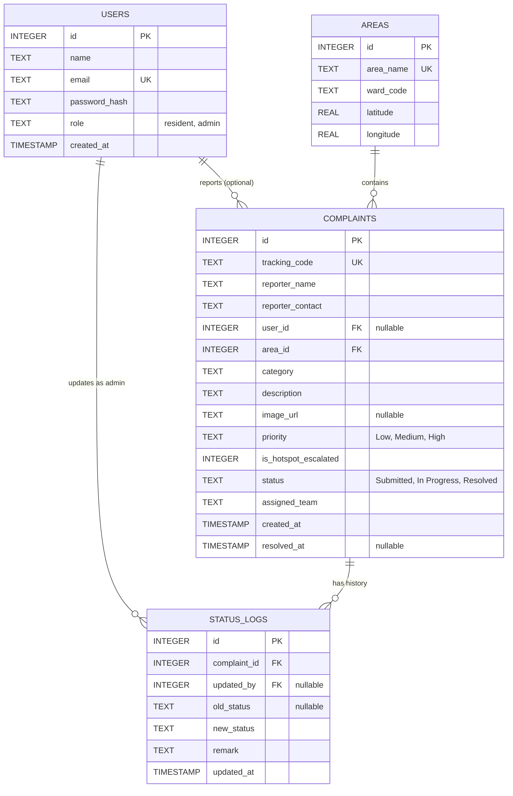

# CleanTrack Architecture & ERD Diagrams

## System Architecture Diagram
```mermaid
flowchart TD
    subgraph Frontend [Browser (HTML/JS/Tailwind)]
        RP[Resident Portal]
        AD[Admin Dashboard]
        MAP[Leaflet Map]
        CHART[Chart.js Analytics]
    end

    subgraph Backend [FastAPI Backend]
        API_PUB[Public Routes]
        API_ADM[Admin Routes]
        AUTH[Auth/Session Manager]
        SVC[Business Logic / Hotspot Engine]
    end

    subgraph Storage [Local Storage]
        DB[(SQLite Database)]
        FS[File System /static/uploads/]
    end

    RP -->|POST /api/complaints| API_PUB
    RP -->|GET /api/complaints/{id}| API_PUB
    RP -->|GET /api/stats/public| API_PUB
    
    AD -->|POST /api/auth/login| AUTH
    AUTH -.->|Signed Cookie| AD
    AD -->|GET /PATCH /api/admin/*| API_ADM
    
    API_PUB --> SVC
    API_ADM --> SVC
    
    SVC -->|Validate & Query| DB
    SVC -->|Save Images| FS
    
    API_ADM -->|Fetch Data| MAP
    API_ADM -->|Fetch Data| CHART
```

## Entity Relationship Diagram (ERD)

