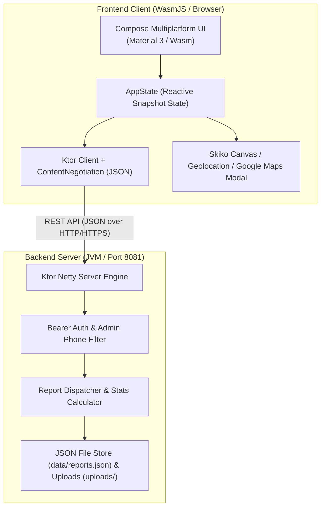
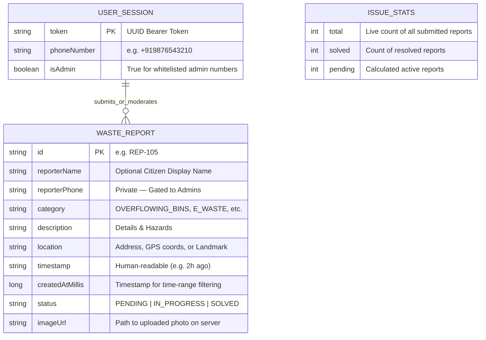

# WasteMan — Hackathon Pitch Deck & Presentation Guide

> A high-impact, 8-slide presentation plan designed to win hackathon judging panels by combining clear problem-solving storytelling with concrete technical architecture.

---

## Slide 1: Title & Hook
- **Slide Title**: WasteMan — Smart Civic Waste Reporting & Action Platform
- **Subtitle / Tagline**: *"Bridging the gap between citizens who spot waste and municipal teams who clear it."*
- **Problem Category**: Civic Technology / Smart Cities / Environmental Cleanliness *(mention your specific hackathon problem statement track here)*
- **Team**: Team Name & Member Names
- **Visuals**:
    - WasteMan eco logo icon
    - Clean preview mockup of both Desktop and Mobile views side by side (`docs/desktop-view.jpg` & `docs/mobile-view.jpg`)

---

## Slide 2: The Problem
- **The Core Issue**:
    - Overflowing municipal dumpsters, hazardous dumping, and street litter often sit untouched for days or weeks.
    - Citizens have no quick, transparent way to report issues or verify whether authorities took action.
    - Municipal cleanup crews lack accurate geo-tagged locations, categorized issue severity, and photo verification to route their trucks efficiently.
- **Who Faces This?**:
    - **Residents & Pedestrians**: Suffer health hazards, foul odors, and blocked walkways.
    - **Municipal Corporations (ULBs / City Workers)**: Waste fuel and time on blind inspections without actionable photo/location data.
    - **The Environment & Local Ecosystem**: Single-use plastics, toxic e-waste, and chemicals clog storm drains and contaminate soil.

---

## Slide 3: Our Solution & User Journey
- **The Solution**: A cross-platform web app powered by Kotlin Wasm & Compose Multiplatform that allows any citizen to report waste in under 30 seconds with instant photo attachment and pin-point GPS/Google Maps location.
- **Citizen Journey (3 Simple Steps)**:
    1. **Snap & Tag**: Open the app, snap or upload a photo, and pick the category (`Overflowing Bins`, `Plastic Waste`, `E-Waste`, etc.).
    2. **Pinpoint Location**: Click **Use GPS** for one-tap browser geolocation or search and pick a landmark on the interactive **Google Maps** modal.
    3. **Track Live**: Watch the status change from **Pending** ➔ **In Progress** ➔ **Solved** on your personal dashboard.
- **Admin Workflow**:
    - Municipal supervisors log in with verified admin credentials to view un-sanitized reports with contact phone numbers, filter by recency/type, and update resolution states in real time.

---

## Slide 4: System Architecture & Data Flow

- **Key Highlights to Mention**:
    - **Zero App Store friction**: Runs natively in any browser at near-native binary speed via **WebAssembly (Kotlin/Wasm)**.
    - **Clean architectural separation**: Shared data contracts (`:core`) ensure 100% type safety across frontend and backend.

---

## Slide 5: Entity-Relationship Diagram (ERD) & Privacy Protection

- **Privacy by Design (Judges Love This!)**:
    - `reporterPhone` is **never leaked** to normal citizen feeds or public search endpoints. The Ktor backend sanitizes citizen views to prevent spam and doxxing.

---

## Slide 6: Tools & Technologies

| Layer | Technology | Why We Chose It |
| :--- | :--- | :--- |
| **Frontend Framework** | **Compose Multiplatform (WasmJS)** | Declarative UI compiling straight to WebAssembly for smooth 60fps animations. |
| **Programming Language** | **Kotlin (100% Kotlin Multiplatform)** | Unified language and business logic shared between UI, domain models, and server. |
| **Backend Framework** | **Ktor Server (Netty engine)** | Lightweight asynchronous coroutine-driven microservice framework. |
| **Networking & Serialization** | **Ktor Client + Kotlinx Serialization** | Type-safe JSON serialization sharing exact DTOs between client and server. |
| **Image Processing & Canvas** | **Skiko + Skia Graphics Engine** | High-performance client-side image decoding and canvas arc rendering. |
| **Platform APIs** | **HTML5 Geolocation & Google Maps Embed** | Browser GPS and interactive embedded map with real-time query updates. |
| **Toolchain & Build** | **Kotlin Toolchain / Amper** | Modern, reproducible multi-module build configuration. |

---

## Slide 7: What We Built (Live Demo & Features)
*(Use the screenshots from your `docs/` folder here)*

1. **Animated Resolution Gauge & Carousel**:
    - Live count-up animations (`Submitted`, `Solved`, `Pending`) from 0 on load.
    - Community news and recycling advisory carousel with auto-advancing progress indicators.
2. **Interactive Map & GPS Picker**:
    - Single-tap GPS coordinates retrieval.
    - Built-in Google Maps modal with quick hotspot pins and search.
3. **Photo Evidence Upload**:
    - Client-side thumbnail scaling and server disk persistence with instant preview.
4. **Responsive Layout & Collapsible Filters**:
    - 2-column wide layout for desktops; collapses to single-column with collapsible filters on mobile screens (`< 680dp`).
5. **Admin Quick Triage**:
    - Interactive dropdown chip right on report cards and detailed modal dialog with instant UI reactivity.

---

## Slide 8: Future Roadmap & Next Steps
- **AI Automated Severity & Triage (Computer Vision)**:
    - Integrate on-device LiteRT/Gemini Nano or cloud vision model to automatically verify if an uploaded image contains actual waste and auto-classify severity.
- **Municipal Route Optimization**:
    - Cluster open reports by GPS proximity to generate the most fuel-efficient route for cleanup trucks.
- **Citizen Karma / Green Rewards**:
    - Gamification with civic points when reports get marked as "Solved" by municipal authorities.
- **Push & SMS Notifications**:
    - Twilio / Web Push alerts to notify citizens: *"Your reported dumpster at Sector 5 has just been cleared!"*
